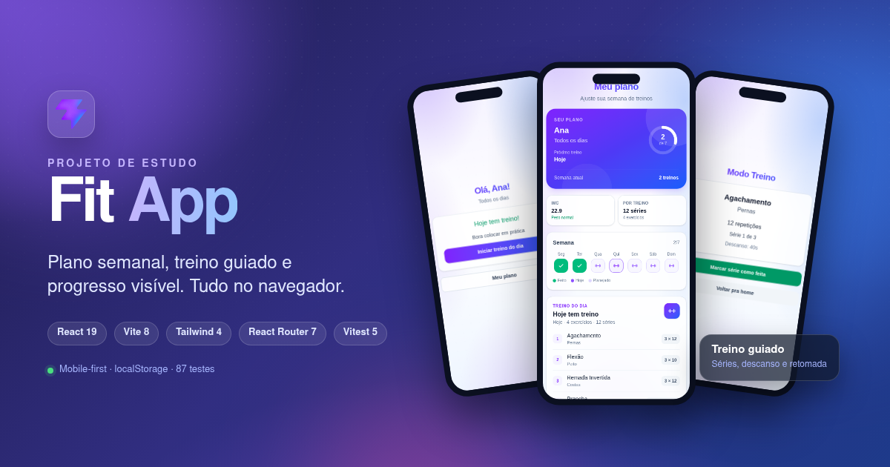
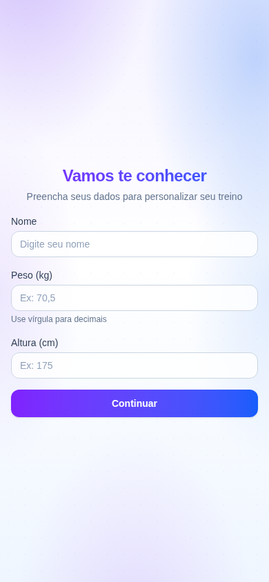
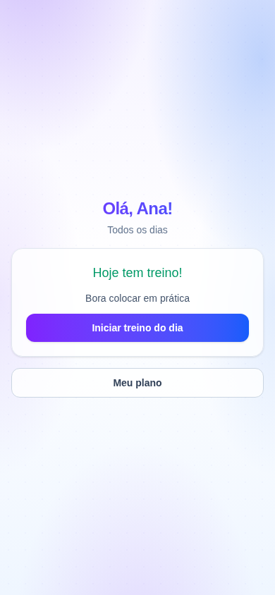
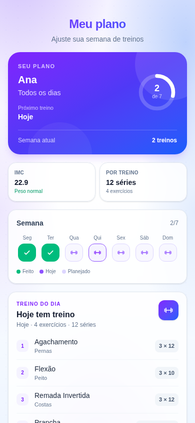
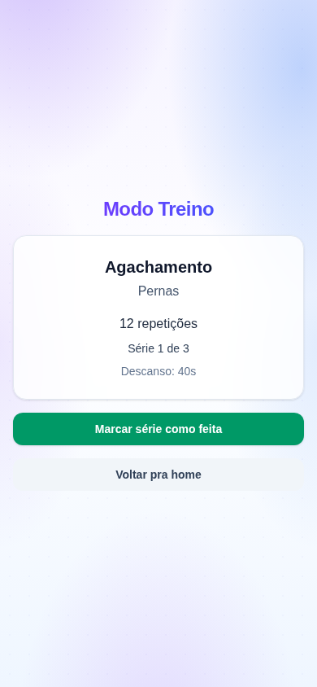

<div align="center">
  
  <h1>Fit App</h1>
  <p>
    <strong>Plano semanal, treino guiado e progresso visível.</strong><br>
    Um app mobile-first para organizar seus treinos — e um laboratório de React.
  </p>

  <p>
    
    
    
    
    
    
    
    
  </p>

  <p>
    <a href="#screenshots">Screenshots</a> ·
    <a href="#destaques">Destaques</a> ·
    <a href="#como-rodar">Como rodar</a> ·
    <a href="#como-contribuir">Como contribuir</a> ·
    <a href="#stack">Stack</a> ·
    <a href="#testes">Testes</a>
  </p>
</div>

<p align="center">
  
</p>

> **Projeto de estudo.** Este app foi construído como prática de React moderno, hooks, `useReducer`, rotas, testes e Tailwind CSS. O processo completo — decisões, bugs, conceitos e limitações — está documentado em [LEARN.md](./LEARN.md).

## Screenshots

<table>
  <tr>
    <td align="center" width="50%">
      <br>
      <sub><strong>Onboarding</strong> — dados, IMC e escolha dos dias</sub>
    </td>
    <td align="center" width="50%">
      <br>
      <sub><strong>Home</strong> — treino do dia, progresso e atalhos</sub>
    </td>
  </tr>
  <tr>
    <td align="center" width="50%">
      <br>
      <sub><strong>Meu plano</strong> — frequência, anel e próximo treino</sub>
    </td>
    <td align="center" width="50%">
      <br>
      <sub><strong>Treino</strong> — exercícios, séries e descanso</sub>
    </td>
  </tr>
</table>

## Destaques

<table>
  <tr>
    <td align="center" width="33%">
      <strong>Plano sob medida</strong><br>
      <sub>Escolha os dias da semana, ajuste a frequência e veja o próximo treino.</sub>
    </td>
    <td align="center" width="33%">
      <strong>Treino guiado</strong><br>
      <sub>Séries, descanso cronometrado e retomada automática no mesmo dia.</sub>
    </td>
    <td align="center" width="33%">
      <strong>Progresso visível</strong><br>
      <sub>Anel semanal, histórico de treinos e conclusão automática.</sub>
    </td>
  </tr>
</table>

## Sobre

O Fit App simula o fluxo de um app de academia:

1. o onboarding coleta nome, peso, altura e os dias de treino;
2. o app calcula o IMC e monta o plano semanal;
3. a home mostra o próximo treino e o progresso da semana;
4. o treino guia exercícios, séries e descanso, com retomada;
5. ao finalizar, a data é registrada no histórico.

Tudo é salvo no **`localStorage`** do navegador. Não existe backend, login ou sincronização entre dispositivos.

## Funcionalidades

- Onboarding em etapas com máscaras de nome, peso e altura.
- Validação de faixas (peso 20–300 kg, altura 50–250 cm) com mensagens inline e acessíveis.
- Cálculo e classificação de IMC.
- Plano semanal editável, com rascunho local e confirmação antes de sair.
- Dashboard com anel de progresso, frequência, próximo treino e histórico da semana.
- Treino guiado com exercícios, séries, descanso cronometrado e opção de pular o descanso.
- Retomada de treino em andamento no mesmo dia.
- Conclusão automática e registro idempotente do treino.
- Rotas protegidas com redirecionamento para o onboarding.
- Persistência local sem perder o progresso ao recarregar a página.
- Acessibilidade: labels, `aria-invalid`, `aria-describedby`, `role="alert"`, `role="switch"` e foco visível.
- 87 testes automatizados cobrindo regras puras, reducer e rotas.

## Stack

<table>
  <tr>
    <td><strong>Tecnologia</strong></td>
    <td><strong>Uso no projeto</strong></td>
  </tr>
  <tr>
    <td><a href="https://react.dev">React 19</a></td>
    <td>Componentes, hooks, <code>useReducer</code> e estado derivado</td>
  </tr>
  <tr>
    <td><a href="https://vite.dev">Vite 8</a></td>
    <td>Dev server, build e preview</td>
  </tr>
  <tr>
    <td><a href="https://tailwindcss.com">Tailwind CSS 4</a></td>
    <td>Layout, tema, gradientes e responsividade</td>
  </tr>
  <tr>
    <td><a href="https://reactrouter.com">React Router 7</a></td>
    <td>Rotas, guards, <code>Navigate</code> e navegação por código</td>
  </tr>
  <tr>
    <td><a href="https://vitest.dev">Vitest 5</a></td>
    <td>Testes unitários e de componente</td>
  </tr>
  <tr>
    <td><a href="https://testing-library.com">Testing Library</a></td>
    <td>Renderização e asserções de DOM</td>
  </tr>
  <tr>
    <td><a href="https://github.com/jsdom/jsdom">jsdom</a></td>
    <td>Ambiente de DOM nos testes</td>
  </tr>
  <tr>
    <td><a href="https://oxc.rs/docs/guide/usage/linter.html">Oxlint</a></td>
    <td>Lint rápido</td>
  </tr>
</table>

**Linguagens:** JavaScript (ES2022+), JSX, HTML5 e CSS3.

<p>
  
  
  
</p>

## Como rodar

Não há demo online. Para testar no seu computador, rode o projeto localmente.

### Pré-requisitos

| Ferramenta | Versão |
|---|---|
| [Node.js](https://nodejs.org) | 22 ou superior (testado com 22.19) |
| npm | vem com o Node.js |
| Git | qualquer versão recente |

Confira no terminal:

```bash
node -v
npm -v
git --version
```

Se `node -v` mostrar uma versão menor que 22, atualize o Node. Com [nvm](https://github.com/nvm-sh/nvm):

```bash
nvm install 22
nvm use 22
```

### 1. Clone o repositório

Com SSH:

```bash
git clone git@github.com:maria-axe/fit-app.git
cd fit-app
```

Ou com HTTPS:

```bash
git clone https://github.com/maria-axe/fit-app.git
cd fit-app
```

Se você fez um **fork**, clone o seu fork e adicione o repositório original como `upstream`:

```bash
git clone git@github.com:SEU_USUARIO/fit-app.git
cd fit-app
git remote add upstream git@github.com:maria-axe/fit-app.git
```

### 2. Instale as dependências

```bash
npm install
```

Para uma instalação limpa, exatamente igual ao `package-lock.json`:

```bash
npm ci
```

Evite usar `sudo` com npm. Se houver erro de permissão, corrija o dono da pasta ou use um gerenciador de versões do Node.

### 3. Rode em modo desenvolvimento

```bash
npm run dev
```

Abra `http://localhost:5173`.

Se a porta estiver ocupada, o Vite escolhe a próxima livre. Para forçar outra porta:

```bash
npm run dev -- --port 5174
```

### 4. Rode os testes e o lint

```bash
npm run lint
npm test
```

Para acompanhar os testes enquanto edita:

```bash
npm run test:watch
```

### 5. Gere o build de produção

```bash
npm run build
npm run preview
```

O build fica em `dist/`. O `preview` serve esse build localmente, por padrão em `http://localhost:4173`.

### Scripts disponíveis

| Comando | O que faz |
|---|---|
| `npm run dev` | Inicia o Vite em modo desenvolvimento |
| `npm run build` | Gera o build de produção em `dist/` |
| `npm run preview` | Serve o build localmente |
| `npm test` | Roda todos os testes uma vez |
| `npm run test:watch` | Roda os testes em modo watch |
| `npm run lint` | Executa o Oxlint |

### Teste manual rápido

Depois de abrir o app:

1. preencha o onboarding com dados válidos e escolha alguns dias;
2. tente avançar com peso `19` ou altura `49` para ver a validação;
3. no plano, alterne os dias, use "Todos"/"Limpar" e salve;
4. inicie um treino, marque séries, pule um descanso e finalize;
5. recarregue a página no meio de um treino para testar a retomada;
6. acesse `/plano` e `/treino` sem usuário para conferir os redirects;
7. apague os dados do site no navegador para resetar o app.

### Onde ficam os dados

| Chave | Conteúdo |
|---|---|
| `fitapp_user` | Nome, peso, altura, frequência e dias de treino |
| `fitapp_treinos_feitos` | Datas ISO dos treinos concluídos |
| `fitapp_treino_em_andamento` | Dia e estado salvo do treino em andamento |

Para resetar tudo, abra o DevTools, vá em **Application → Local Storage** e apague as três chaves. Ou rode no console:

```js
localStorage.clear()
```

Depois recarregue a página.

### Problemas comuns

<details>
  <summary><strong>Node.js ou Vite reclamando da versão</strong></summary>

  Atualize para Node 22+:

  ```bash
  nvm install 22
  nvm use 22
  node -v
  ```
</details>

<details>
  <summary><strong>Porta 5173 ocupada</strong></summary>

  Use outra porta:

  ```bash
  npm run dev -- --port 5174
  ```
</details>

<details>
  <summary><strong>Erro estranho depois de trocar de branch</strong></summary>

  Reinstale as dependências a partir do lockfile:

  ```bash
  rm -rf node_modules
  npm ci
  ```
</details>

<details>
  <summary><strong>Testes falhando por causa de localStorage</strong></summary>

  Os testes limpam o `localStorage` depois de cada caso. Se estiver rodando um teste isolado, confirme que está usando o setup de `src/test/setup.js`:

  ```bash
  npx vitest run src/App.test.jsx
  ```
</details>

## Como contribuir

Contribuições são bem-vindas, principalmente em melhorias de acessibilidade, testes e documentação. Como é um projeto de estudo, mudanças maiores devem ser combinadas antes.

### Antes de começar

- Abra uma [issue](https://github.com/maria-axe/fit-app/issues) descrevendo o problema ou a ideia.
- Para mudanças grandes, espere o retorno antes de investir tempo.
- Para correções pequenas, sinta-se livre para abrir um PR direto.

### Fluxo com fork

1. Faça um fork no GitHub.
2. Clone o seu fork:

   ```bash
   git clone git@github.com:SEU_USUARIO/fit-app.git
   cd fit-app
   git remote add upstream git@github.com:maria-axe/fit-app.git
   ```

3. Atualize a `main` e crie uma branch:

   ```bash
   git fetch upstream
   git checkout -b feat/minha-melhoria upstream/main
   ```

4. Faça as alterações.
5. Rode a verificação local:

   ```bash
   npm run lint
   npm test
   npm run build
   ```

6. Faça commit:

   ```bash
   git add .
   git commit -m "feat: descreva sua melhoria"
   ```

7. Envie a branch e abra um PR para `maria-axe:main`:

   ```bash
   git push -u origin feat/minha-melhoria
   ```

Se você for colaborador do repositório, pode criar a branch direto nele, sem fork.

### Padrões do projeto

- Componentes de domínio ficam em `src/features/`; componentes genéricos, em `src/components/`.
- Regras puras ficam em `src/lib/` e devem ter teste.
- Estado complexo de treino passa pelo `treinoReducer`.
- Persistência fica isolada no hook `useLocalStorage`.
- Mantenha acessibilidade: labels, `aria-*`, foco visível e mensagens com `role="alert"`.
- Não adicione backend sem discutir antes: o projeto é local por design.
- Evite dependências novas sem necessidade; prefira APIs do React e do navegador.
- Mudanças de comportamento relevante devem atualizar o [LEARN.md](./LEARN.md).

### Checklist do PR

- [ ] `npm run lint` passa.
- [ ] `npm test` passa.
- [ ] `npm run build` passa.
- [ ] Testei o fluxo manualmente no navegador.
- [ ] Atualizei o `LEARN.md` se mudei comportamento ou arquitetura.
- [ ] O PR explica o problema, a solução e como testar.

## Rotas

| Rota | Tela | Acesso |
|---|---|---|
| `/onboarding` | `Onboarding` | Público; se já existe usuário, redireciona para `/` |
| `/` | `Home` | Protegida |
| `/plano` | `MeuPlano` | Protegida |
| `/treino` | `Workout` | Protegida |
| `*` | Fallback | `/` se logado; `/onboarding` se não |

As rotas protegidas usam uma layout route com `<Outlet />`. Sem usuário, `LayoutProtegido` devolve `<Navigate to="/onboarding" replace />`.

## Estrutura

<details>
  <summary><strong>Ver árvore de pastas</strong></summary>

```text
fit-app/
├── docs/
│   ├── banner.png            # banner do README
│   └── screenshots/          # capturas das telas
├── public/                   # favicon e sprites SVG
├── src/
│   ├── components/           # Screen e Button
│   ├── data/                 # dias da semana e exercícios
│   ├── features/
│   │   ├── home/             # dashboard inicial
│   │   ├── onboarding/       # formulário, IMC e escolha dos dias
│   │   ├── plan/             # plano semanal, anel e dashboard
│   │   └── workout/          # execução, descanso e reducer
│   ├── hooks/                # useLocalStorage
│   ├── lib/                  # datas, IMC, máscaras, validação, semana
│   ├── test/                 # setup do Vitest/Testing Library
│   ├── App.jsx               # rotas, guards e estado principal
│   └── main.jsx              # BrowserRouter e mount do React
├── LEARN.md                  # diário de estudo por rodada
├── vitest.config.js
└── vite.config.js
```
</details>

Decisões principais:

- **`features/`** agrupa código por domínio, não por tipo de arquivo.
- **`lib/`** concentra funções puras e testáveis, sem React.
- **`treinoReducer`** modela o treino como máquina de estados.
- **`useLocalStorage`** isola a persistência do resto da UI.
- **`App.jsx`** compõe rotas e estado, mantendo as telas focadas em apresentação.

## Testes

```bash
npm test
npx vitest run src/App.test.jsx   # apenas testes de rota
```

Cobertura atual:

- funções puras de datas, IMC, máscaras, validação, seleção de dias e semana;
- reducer do treino;
- renderização e redirects das rotas com `MemoryRouter`.

**87 testes em 8 arquivos.** Ainda não há cobertura (`@vitest/coverage-v8`) nem CI.

## Diário de estudo

O [LEARN.md](./LEARN.md) registra cada rodada, incluindo problema, solução, conceitos e limitações.

<details>
  <summary><strong>Ver as 12 rodadas</strong></summary>

| Rodada | Tema |
|---:|---|
| 1 | Refactor por feature, `useReducer` e `useLocalStorage` |
| 2 | Conclusão automática e progresso persistido |
| 3 | Plano semanal editável |
| 4 | Layout com `Screen` e `Button` |
| 5 | Tema roxo/azul com gradientes |
| 6 | Dashboard, anel SVG e switch acessível |
| 7 | Máscaras de formulário |
| 8 | Validação de faixas com mensagens inline |
| 9 | Testes com Vitest |
| 10 | Extração de componentes do `MeuPlano` |
| 11 | Rotas com React Router |
| 12 | Testes de rota com Testing Library |
</details>

## Limitações e roadmap

- O treino é fixo: os mesmos exercícios para qualquer perfil.
- O histórico é por dia, não por sessão (sem duração ou séries individuais).
- Sem backend, autenticação ou sincronização entre dispositivos.
- Sem dark mode e com a paleta ainda hardcoded em utilities do Tailwind.
- O alertdialog do plano ainda não tem focus trap nem fechamento com `Escape`.
- Dados antigos fora da faixa de validação ainda não são migrados.
- Sem cobertura de testes nem pipeline de CI.

Ideias para as próximas rodadas:

- [ ] Gerar o treino a partir do perfil e dos dias escolhidos.
- [ ] Registrar histórico por sessão, com duração e séries.
- [ ] Adicionar focus trap e `Escape` ao alertdialog.
- [ ] Implementar dark mode com tokens no `@theme`.
- [ ] Configurar cobertura e CI.
- [ ] Testar interações com `userEvent`.

## Licença

Projeto pessoal de estudo. Não há licença definida no repositório.

<div align="center">
  <sub>Feito como projeto de estudo de React · 2026</sub>
</div>
